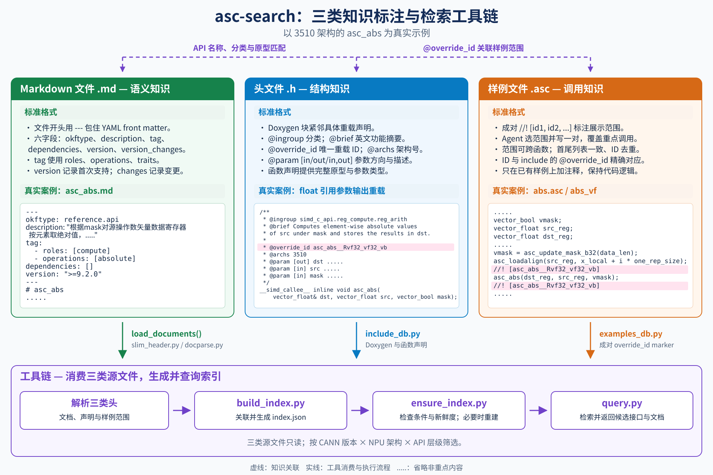

# OKF Search README

`asc-search` 接受 Agent 整理的关键词/结构化条件，返回机器可读 JSON。
自然语言澄清和最终答案组织由调用方负责，本 skill 不依赖人类入口。
外部资源使用显式 `--root` 和独立 `--index-dir`，不会依赖安装目录所在仓库的数据。
命令契约见 [SKILL.md](SKILL.md)。

## 快速开始

先克隆完整的 asc-devkit 仓库，在仓库根目录执行（Python 3.10+）：

```bash
python3 .agent/skills/asc-search/scripts/install.py
```

这一条命令将 `asc-search` 以软链安装到 Codex、Claude Code、OpenCode 的用户 skill 目录，
重复执行无需重新安装，已有同名且指向其他位置的 skill 会保留并报出冲突。

| 智能体 | 默认安装位置 |
| --- | --- |
| Codex | `~/.agents/skills/asc-search` |
| Claude Code | `~/.claude/skills/asc-search` |
| OpenCode | `~/.config/opencode/skills/asc-search`（设置 `XDG_CONFIG_HOME` 时使用对应配置目录） |

只安装到一个智能体或仅在本项目启用时，可选择：

```bash
python3 .agent/skills/asc-search/scripts/install.py --agent codex
python3 .agent/skills/asc-search/scripts/install.py --scope project
```

`--agent` 可选 `codex`、`claude`、`opencode` 或 `all`（默认）；`--scope project` 使用项目内的
`.agents/skills`、`.claude/skills`、`.opencode/skills`。加 `--dry-run` 可预览安装位置。

检索脚本还依赖 PyYAML；当前 Python 环境未安装时执行：

```bash
python3 -m pip install PyYAML
```

安装后重启或重新加载智能体，使其发现机器检索入口。保留原 devkit checkout；移动仓库后需要重新安装软链。

## 1. 这个 skill 是干什么的

### 1.1 背景

写 Ascend C 算子要用 C API 时，面对的是 800 多篇文档，凭记忆按目录翻很慢。`asc-search` 把这些
文档整理成一个能检索的库：调用方提供关键词和结构化条件，获得候选及来源定位。

### 1.2 它靠什么工作

靠文档里预先写好的三类头：

| 头 | 在哪 | 给检索提供什么 |
| --- | --- | --- |
| 文档头 | 每篇 Markdown 顶部的 6 字段 YAML（兼容存量 5 字段） | 语义：做什么、什么操作、配套什么、哪个版本可用 |
| include 头 | `include/c_api/**/*.h` 声明上方的 Doxygen | 结构：重载编号、适用架构、参数方向 |
| examples 头 | 每源文件重点 API 共同范围首尾的 `//! [id1, id2, ...]` 成对标记 | 关联：同一展示范围对应哪些重载；单 ID 标记仍兼容 |

`asc-search` 把三类头推导成一份持久索引，查询时只查索引、按需打开候选文档，不需要现场全文搜索。



### 1.3 两个工作流

1. **建立索引**：三类头 → 按适用条件筛选的持久索引（CANN 版本 × 架构 × 层级）。索引是纯派生数据，
   校验不过不出索引，同样输入两次构建结果字节一致。
2. **使用索引（检索）**：接收结构化条件 → 检查索引新鲜度 → 查询 → 返回 JSON 候选。

### 1.4 边界

- 只帮找文档，不生成算子代码、不替你写 kernel。
- 当前只覆盖 C API（`docs/zh/api/SIMD-API/c_api/`）；其他层级会如实标注"范围外"。
- 不改文档、不改索引构建产物。

## 2. 机器检索接口

数据根、索引目录、目标版本与架构由调用方指定；`--root`、`--out`、`--index-dir` 省略时分别默认取
skill 所在仓库根与 skill 内 `index/<surface>`。先构建独立索引，再进行只读查询：

```bash
python3 .agent/skills/asc-search/scripts/build_index.py --arch 3510 --cann-version 9.2.0
python3 .agent/skills/asc-search/scripts/search.py --platform 950 --version 9.2.0 --api asc_abs --dtype float
```

非 Git 快照传入 `--source-commit <commit>`；未提供时来源为 `unversioned`，不使用外层仓库 HEAD。
短关键词与结构化条件求交，输出为 `asc-search-results/1` JSON；候选包含版本上下文、文档、声明和样例位置。
`--gap` 是独立的缺口登记查询，不与 `--keywords` 组合。查询不联网、不重建索引；索引缺失或过期时返回错误，交由调用方处理。

### 2.1 检索实测示例

以下结果在本地完整标注数据根（带三类头的独立 asc-devkit checkout）上构建 **CANN 9.2.0 × 3510 × C API**
索引后直接运行 `search.py` 检索得到；换版本或架构后需重新准备索引，结果可能不同。

```bash
python3 .agent/skills/asc-search/scripts/build_index.py \
  --root /path/to/annotated/asc-devkit --out /tmp/asc-search-idx --arch 3510 --cann-version 9.2.0
```

本机实测索引规模：主文档 602 篇、导航页 14 篇、按架构过滤 243 篇、按版本过滤 0 篇，
范围内无缺 slim 头的文档。以下卡片以关键字列出 `search.py` 的检索条件（统一带 `--platform 950 --version 9.2.0`），答案按实测命中整理。

<details>
<summary>问答 1：operation=absolute</summary>

**答：** 用 `asc_abs`；如果需要“两数相减后再取绝对值”的融合计算，用 `asc_abs_sub`。

| 接口与文档 | 用途与选择条件 |
| --- | --- |
| [asc_abs](../../../docs/zh/api/SIMD-API/c_api/reg_compute/reg_arith/asc_abs.md) | 按 mask 对矢量寄存器元素逐元素取绝对值，结果写入目的寄存器或由函数返回值返回；支持 int8、int16、half、int32、float，仅 AIV 生效。 |
| [asc_abs_sub](../../../docs/zh/api/SIMD-API/c_api/reg_compute/reg_fused/asc_abs_sub.md) | 按掩码对两个矢量寄存器逐元素相减并取绝对值的融合计算，支持 half、float，提供写入 dst 引用与函数返回值两种形式。 |

</details>

<details>
<summary>问答 2：operation=copy, stage=in</summary>

**答：** 命中 25 篇，按源/目的位置和是否随路转换区分。GM→UB 首选 `asc_copy_gm2ub`，非对齐或高维场景用
`asc_copy_gm2ub_align`、`asc_ndim_copy_gm2ub`；GM→L1 的格式转换与矩阵搬运用 `asc_copy_gm2l1_*` 系列；
L1→L0A/L0B、L1→Fixpipe Buffer、L1→UB 分别为 `asc_copy_l12l0a/l12l0b`、`asc_copy_l12fb`、`asc_copy_l12ub`。
旧同步/整数缓存参数重载仍在结果中，并标注废弃与替代方案。

| 接口与文档 | 用途与选择条件 |
| --- | --- |
| [asc_copy_gm2ub](../../../docs/zh/api/SIMD-API/c_api/vector_datamove/asc_copy_gm2ub/asc_copy_gm2ub_arch_3510.md) | GM→UB，连续搬运与高维切分搬运；有效长度非 32 字节对齐时在 UB 侧补齐。 |
| [asc_copy_gm2ub_align](../../../docs/zh/api/SIMD-API/c_api/vector_datamove/asc_copy_gm2ub_align/asc_copy_gm2ub_align_arch_3510.md) | GM→UB，长度非 32 字节整数倍时补齐，支持 Compact/Normal 切分与常量填充。 |
| [asc_ndim_copy_gm2ub](../../../docs/zh/api/SIMD-API/c_api/vector_datamove/asc_ndim_copy_gm2ub.md) | GM→UB，最多 5 维、各维独立步长，支持随路 Padding。 |
| [asc_copy_gm2l1_nd2nz](../../../docs/zh/api/SIMD-API/c_api/cube_datamove/cube_compute_load/asc_copy_gm2l1_nd2nz_arch_3510.md) | GM→L1，ND→Nz 分形转换，支持 12 种数据类型与 SmallC0。 |
| [asc_copy_gm2l1_align](../../../docs/zh/api/SIMD-API/c_api/cube_datamove/cube_compute_load/asc_copy_gm2l1_align.md) | GM→L1，长度非 32 字节对齐时补齐，支持左右/循环填充。 |
| [asc_copy_l12l0a](../../../docs/zh/api/SIMD-API/c_api/cube_datamove/cube_compute_load/asc_copy_l12l0a_2d_arch_3510.md)、[asc_copy_l12l0b](../../../docs/zh/api/SIMD-API/c_api/cube_datamove/cube_compute_load/asc_copy_l12l0b_2d_arch_3510.md) | L1→L0A/L0B，2D 分形搬运与转置，另有 3D im2col 形式。 |
| [asc_copy_l12fb](../../../docs/zh/api/SIMD-API/c_api/cube_datamove/cube_compute_load/asc_copy_l12fb_arch_3510.md) | L1→Fixpipe Buffer，搬入随路量化/激活参数。 |
| [asc_copy_l12ub](../../../docs/zh/api/SIMD-API/c_api/cube_datamove/cube_compute_store/asc_copy_l12ub.md)、[asc_copy_l0c2ub](../../../docs/zh/api/SIMD-API/c_api/cube_datamove/cube_compute_store/asc_copy_l0c2ub.md) | L1→UB；L0C→UB，支持随路量化、激活与 Nz2ND 转换。 |

</details>

<details>
<summary>问答 3：convert=float→fp8_e4m3fn</summary>

**答：** 用 `asc_float2e4m3`（CANN 9.2.0 起），按 RINT 舍入和饱和/非饱和模式转换，结果按 `dst_quarter_pos`
写入目的寄存器四分之一位置的离散元素、其余位置清零，也可由函数返回值返回；同族废弃页对应旧的无显式位置参数原型。

| 接口与文档 | 用途 |
| --- | --- |
| [asc_float2e4m3](../../../docs/zh/api/SIMD-API/c_api/reg_compute/reg_convert/asc_float2e4m3.md) | float→`fp8_e4m3fn_t`，RINT 舍入，饱和/非饱和两种形式，仅 AIV 生效。 |
| [asc_float2e4m3（废弃）](../../../docs/zh/api/SIMD-API/c_api/deprecated_interface/asc_float2e4m3_deprecated.md) | 旧的 float→`fp8_e4m3fn_t` 重载，无显式位置参数的原型已废弃，替代方案为显式位置参数重载。 |

</details>

<details>
<summary>问答 4：deps-of=asc_copy_gm2ub_align, kind=configures, reverse</summary>

**答：** 按反向依赖（`kind=configures`）检索，命中 `asc_set_copy_pad_val`：它为连续搬运数据块设置左右填充值，
仅在 `enable_constant_pad=true` 时生效，支持 int8_t 到 float 共 9 种 dtype。

| 配套接口与文档 | 何时使用 |
| --- | --- |
| [asc_set_copy_pad_val](../../../docs/zh/api/SIMD-API/c_api/vector_datamove/asc_set_copy_pad_val.md) | 使用 `asc_copy_gm2ub_align` 且需要常量填充时，搬运前配置左右填充值。 |

</details>

<details>
<summary>问答 5：param=asc_load_l2_cache_mode</summary>

**答：** 命中 13 篇，覆盖标量读写路径的 L2 策略设置与 GM→UB、GM→L1 搬运接口。
旧的 uint8 型 `l2_cache_ctl` 重载已废弃，替代方案统一改用 `asc_load_l2_cache_mode` 枚举重载。

| 接口与文档 | 用途 |
| --- | --- |
| [asc_set_scalar_cache_mode](../../../docs/zh/api/SIMD-API/c_api/cache_ctrl/asc_set_scalar_cache_mode.md) | 设置标量访问 Global Memory 的 L2 Cache 管理策略。 |
| [asc_copy_gm2ub_align](../../../docs/zh/api/SIMD-API/c_api/vector_datamove/asc_copy_gm2ub_align/asc_copy_gm2ub_align_arch_3510.md) | GM→UB 非对齐搬运，可按枚举配置 L2 策略。 |
| [asc_ndim_copy_gm2ub](../../../docs/zh/api/SIMD-API/c_api/vector_datamove/asc_ndim_copy_gm2ub.md) | GM→UB 多维搬运，末参为 L2 策略枚举。 |
| [asc_copy_gm2l1_align](../../../docs/zh/api/SIMD-API/c_api/cube_datamove/cube_compute_load/asc_copy_gm2l1_align.md) | GM→L1 非对齐搬运，支持 L2 策略枚举。 |
| [asc_copy_gm2l1_nd2nz](../../../docs/zh/api/SIMD-API/c_api/cube_datamove/cube_compute_load/asc_copy_gm2l1_nd2nz_arch_3510.md) | GM→L1 的 ND→Nz 转换搬运，支持 L2 策略枚举。 |
| [asc_copy_gm2l1_dn2nz](../../../docs/zh/api/SIMD-API/c_api/cube_datamove/cube_compute_load/asc_copy_gm2l1_dn2nz.md) | GM→L1 的 DN→Nz 转换搬运，支持 L2 策略枚举。 |

</details>

<details>
<summary>问答 6：changed-in=9.2.0</summary>

**答：** `--changed-in 9.2.0` 命中 270 篇文档，均为文档头 `version_changes` 记录了 9.2.0 事件（新增重载、
参数/返回值变化等）的接口，例如随路原子配置与标量原子操作。结果中的 `version_context` 会带上该版本的
事件摘要与依据，仍需结合文档正文确认具体原型。

| 接口与文档 | 9.2.0 相关变更类型 |
| --- | --- |
| [asc_set_atomic_add](../../../docs/zh/api/SIMD-API/c_api/atomic/datamove_atomic/asc_set_atomic_add.md) | 为 GM 目的地址开启随路原子累加，提供多种数据类型原型。 |
| [asc_set_atomic_max](../../../docs/zh/api/SIMD-API/c_api/atomic/datamove_atomic/asc_set_atomic_max.md)、[asc_set_atomic_min](../../../docs/zh/api/SIMD-API/c_api/atomic/datamove_atomic/asc_set_atomic_min.md) | 随路原子比较取大/取小配置。 |
| [asc_atomic_add](../../../docs/zh/api/SIMD-API/c_api/atomic/scalar_atomic/asc_atomic_add.md) | GM 单元素原子加，返回旧值。 |

</details>

`--gap` 与 `--version` 等过滤维度组合会返回明确的 JSON 参数错误（缺口是范围外登记，不与文档维度求交）。
每条候选同时携带 `version_context`、`signatures`、`header_locations` 与 `example_locations`，
调用方据此打开实际文档、声明和样例位置核对。完整数据回归命令见文末。

### 2.2 noLLM 模式：直接输出检索用例期望片段

默认 `search.py` 输出中间结果，由调用方 LLM 整理成答复。传入 `noLLM`（CLI 开关 `--no-llm`，
也可设环境变量 `ASC_SEARCH_NO_LLM=1`）后跳过整理环节，按检索用例格式输出期望片段：
单候选输出 `expected`（只有一项），多候选输出 `expected_any`（同一组，任一项命中即可）。
输入为空格分隔的短关键词（与检索用例 `query` 写法一致，全部命中才入选）：

```bash
python3 .agent/skills/asc-search/scripts/search.py --platform 950 --version 9.2.0 \
  --keywords 相减 绝对值 --no-llm
```

实测输出（CANN 9.2.0 × 3510 × C API，单候选）：

```yaml
expected:
  - docs/zh/api/SIMD-API/c_api/reg_compute/reg_fused/asc_abs_sub.md
```

多候选用例（关键词 `取绝对值 矢量`）：

```bash
python3 .agent/skills/asc-search/scripts/search.py --platform 950 --version 9.2.0 \
  --keywords 取绝对值 矢量 --no-llm
```

```yaml
expected_any:
  - - docs/zh/api/SIMD-API/c_api/reg_compute/reg_arith/asc_abs.md
    - docs/zh/api/SIMD-API/c_api/reg_compute/reg_fused/asc_abs_sub.md
```

路径相对数据根，可直接打开；无命中时不输出内容，错误仍返回 JSON（`{"status": "error", ...}`）。

## 3. 三类头的标准格式与真实示例

三类头分别描述 API 的语义、具体重载的结构和源码调用范围。本章以 3510 架构的 `asc_abs`
为贯穿示例，样例源码使用仓库原有的 `abs.asc`，只增加 marker 注释。真实片段取自
`okf-knowledge-user` 分支；本 README 在 user、test 两分支保持一致，示范文件的标注范围
可以不同。索引如何推导这些字段见[索引推导契约](references/index_derivation_contract.md)。

### 3.1 文档头：Markdown YAML front matter

**标准格式**

文档开头使用 `---` 包住 YAML，固定六个字段并按以下顺序排列。下方模板的占位内容需替换为
实际摘要、冻结词表值、依赖目标、首次支持版本及变更事件；没有依赖时写 `dependencies: []`。

```yaml
---
okftype: reference.api
description: "接口核心动作、处理对象与关键约束的中文摘要。"
tag:
  - roles: [角色标签]
  - operations: [操作标签]
  - traits: [特性标签]
dependencies:
  - path: docs/zh/api/相关文档.md
    kind: constrained_by
version: ">=首次支持版本号"
version_changes: []
---
# API 名称
```

| 字段 | 标准含义 |
| --- | --- |
| `okftype` | 页面种类；本例为接口文档 `reference.api`。 |
| `description` | 简洁说明核心行为和关键约束。 |
| `tag` | 只写 `roles`、`operations`、`traits`，值来自冻结词表；不适用的 namespace 省略。 |
| `dependencies` | 正文有依据的文档关系，包含 `path`、`kind`；条件关系可带 `condition`。 |
| `version` | 接口首次支持版本，只写 `>=版本号`。 |
| `version_changes` | 新增重载、返回值/参数变化、废弃、移除等版本事实；没有事件写 `[]`。 |

架构、签名、重载 ID、头文件位置和样例关联由索引推导，不写入这些字段。

**真实示例**

来源：`docs/zh/api/SIMD-API/c_api/reg_compute/reg_arith/asc_abs.md`。

```yaml
---
okftype: reference.api
description: "根据mask对源操作数矢量数据寄存器按元素取绝对值，结果写入目的操作数或通过函数返回值返回；输入为有符号整数类型最小负值时结果保留原值不变。"
tag:
  - roles: [compute]
  - operations: [absolute]
dependencies: []
version: ">=9.2.0"
---
# asc_abs
```

该头表达逐元素取绝对值的行为和有符号整数最小负值的处理约束；`dependencies: []`
表示当前未标注文档依赖。文档标题和正文原型用于匹配 include 声明。

### 3.2 include 头：Doxygen 与函数声明

**标准格式**

Doxygen 块放在每个具体重载声明上方，功能摘要和参数描述使用英文。每个重载用一句 `@brief`
说明核心动作及结果输出方式，术语参考 `docs/en/`；摘要后用一行空注释结束，再写结构字段。
`override_id` 按具体签名生成，
同名函数的不同重载各有独立 ID；参数类型来自紧随注释的声明。

```cpp
/**
 * @ingroup simd_c_api.<API category>
 * @brief <English summary of the concrete overload's behavior and result output>
 *
 * @override_id <canonical overload ID>
 * @archs <NPU architecture numbers>
 * @param [out] dst Destination operand.
 * @param [in] src Source operand.
 * @param [in,out] state Input and output state.
 */
// The corresponding concrete function declaration follows here.
```

| 标注 | 标准含义 |
| --- | --- |
| `@ingroup` | API 所属分类。 |
| `@brief` | 具体重载的一句英文功能摘要，区分输出参数与返回值形式。 |
| `@override_id` | 具体重载的唯一 ID，也是连接样例的键。 |
| `@archs` | 适用架构号，如 `3510`；多个架构按空格分隔。 |
| `@param [in/out/in,out]` | 参数名、方向及英文语义描述，需与声明对应。 |

**真实示例**

来源：`include/c_api/reg_compute/compute/reg_arith.h`，以下展示通过引用参数输出结果的 `float` 重载。

```cpp
/**
 * @ingroup simd_c_api.reg_compute.reg_arith
 * @brief Computes element-wise absolute values of src under mask and stores the results in dst.
 *
 * @override_id asc_abs__Rvf32_vf32_vb
 * @archs 3510
 * @param [out] dst Destination operand (vector data register).
 * @param [in] src Source operand (vector data register).
 * @param [in] mask Mask register that controls whether each element participates in the computation.
 * A value of 1 selects the corresponding element; a value of 0 excludes it. Unselected elements are set to zero.
 */
__simd_callee__ inline void asc_abs(vector_float& dst, vector_float src, vector_bool mask);
```

`dst` 是输出，`src`、`mask` 是输入；`@archs 3510` 表示适用 3510 架构。同名函数的其他
数据类型和返回方式有独立 ID，例如返回 `float` 矢量的重载使用 `asc_abs__vf32_vb`。
该返回值形式的摘要为 `@brief Returns element-wise absolute values of src under mask.`。
`@brief` 供开发者阅读，当前索引仍从文档头获取语义摘要，不额外索引 include 的 brief。

### 3.3 样例头：成对 override_id marker

**标准格式**

Agent 为每个源文件选择覆盖全部重点 API 调用的语义范围，直接写入一对 marker；
应保留必要上下文，可跨函数，但不能机械取首末调用。首尾 ID 列表一致，ID 去重，并与 include 中的 `@override_id`
精确对应。范围是展示片段，不要求独立编译。只在仓库已有样例上增加 marker 注释，不新建样例或改写代码逻辑。

```cpp
//! [id1, id2, ...]
// Shared source range containing the featured API calls.
//! [id1, id2, ...]
```

只有一个重载时仍使用 `//! [override_id]`；同一重载调用多次，在列表中只出现一次。

**真实示例**

来源：`examples/02_simd_c_api/03_c_api/02_reg_vector_compute/abs/abs.asc`，以下为 `abs_vf` 函数内片段。
该文件原本就存在，标注只增加首尾两行注释。

```cpp
vector_bool vmask;
vector_float src_reg;
vector_float dst_reg;
for (uint16_t i = 0; i < repeat_time; ++i) {
    vmask = asc_update_mask_b32(data_len);
    asc_loadalign(src_reg, x_local + i * one_rep_size);
    //! [asc_abs__Rvf32_vf32_vb]
    asc_abs(dst_reg, src_reg, vmask);
    //! [asc_abs__Rvf32_vf32_vb]
    asc_storealign(y_local + i * one_rep_size, dst_reg, vmask);
}
```

三类头通过“文档的 API 名称与原型 → include 具体声明 → `override_id` → 样例范围”关联。
`build_index.py` 消费它们生成索引，`ensure_index.py` 检查索引新鲜度，`query.py` 再从索引检索
接口、文档和样例关联。

## 版本与源码标注的当前约定

version 表示接口首次支持，仅写 `>=版本号`；页面出现不等于每个重载已支持。
新增重载、返回值、参数、废弃及实际移除由 version_changes 区分。检索结果包含目标版本与事件上下文，
按需核对后才能推荐具体原型。旧带上限的头会进入 unresolved，兼容时只使用其首次支持部分。
上文历史问答卡片与真实片段是当时快照，不能作为历史首次支持或当前所有重载可用性的证据。

样例范围由 Agent 选择并直接写两行 marker；search 只读取并关联，不自动裁剪。
include brief/params 与中文 description 经建设侧 Agent 语义复核，脚本保证绑定、证据和受控写入，
不宣称能机械证明语义正确。

完整数据回归可通过 `ASC_SEARCH_TEST_ROOT=/path/to/annotated/asc-devkit` 指定带三类头的独立数据根，再运行 `python3 -m unittest discover -s .agent/skills/asc-search/tests`（知识仓对应 `.agents/skills/asc-search/tests`）。未安装完整标注数据时，仅跳过真实语料用例，合成快照与版本匹配测试仍执行。
