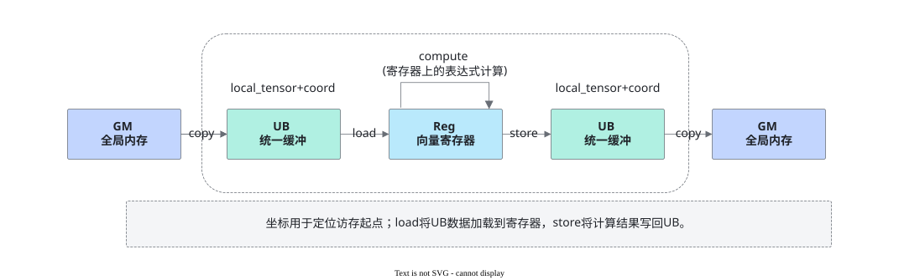

# Reg矢量计算编程<a name="ZH-CN_TOPIC_0000002509863892"></a>

本文介绍如何使用基础API（C++模板接口）编写Reg矢量计算代码。基础API与[Reg矢量计算编程（语言扩展C API）](../c_pointer_programming/reg_vector_computation.md)描述的是同一套Reg矢量硬件能力，功能语义一致，主要区别在于API命名、类型表达和可配置参数的表达方式。

Reg矢量编程的硬件原理、内存层级、VF函数执行域、流水线同步、Hardware Loop、VF融合等与API接口命名无关的内容，请参见[Reg矢量计算编程（语言扩展C API）](../c_pointer_programming/reg_vector_computation.md)。本文只说明基础API的接口定位、模板参数、数据类型体系、API分类和典型调用方式。

## 基础API定位<a name="section_part1"></a>

基础API Reg矢量计算接口位于`AscendC::Reg`命名空间，是语言扩展C API的C++模板化封装。基础API并不改变Reg矢量计算的编程模型：仍然需要在`__aicore__`域通过`asc_vf_call`进入`__simd_vf__`函数，并在VF函数内完成`Load` -> `Compute` -> `Store`。

基础API的主要特点如下：

- 使用C++类型表达寄存器对象，例如`RegTensor<T>`、`MaskReg`、`AddrReg`、`UnalignRegForLoad`、`UnalignRegForStore` ,对应关系参考[数据对象与寄存器类型](#section_part4)。
- 使用模板参数表达数据类型、搬运模式、PostUpdate模式等配置。
- 多数接口可通过参数自动推导寄存器类型。
- 搬运接口可以与`LocalTensor`衔接，可以支持不操作Unified Buffer（UB）地址，也可以外层`__aicore__`代码从`LocalTensor::GetPhyAddr()`获取UB物理地址，再传入VF函数内的Reg搬运接口。
- 部分计算接口提供`MaskMergeMode`模板参数，用于控制未被mask选中的元素如何写入目的寄存器。

> 📌 **提示**：
>
> 1. 基础API和C API功能一致。若需要理解“为什么需要Reg矢量编程”“寄存器与UB/GM的关系”“哪些场景需要同步”等模型性内容，请直接阅读C API版本文档。
>
> 2. 搬运接口支持`LocalTensor`参数，在后续版本提供，暂未支持。

## 与C API的对应关系<a name="section_part2"></a>

基础API与C API的核心差异是表达形式不同。

| 维度 | 基础API（C++模板） | C API（语言扩展） |
| --- | --- | --- |
| 命名空间/前缀 | `AscendC::Reg::*` | `asc_*` |
| 命名风格 | `LoadAlign`、`StoreUnalignPost` | `asc_loadalign`、`asc_storeunalign_post` |
| 矢量数据寄存器 | `RegTensor<T>` | `vector_float`、`vector_half`、`vector_int32_t`等 |
| 掩码寄存器 | `MaskReg` | `vector_bool` |
| 地址寄存器 | `AddrReg` | `addr_reg` |
| 非对齐搬入/搬出寄存器 | `UnalignRegForLoad` / `UnalignRegForStore` | `vector_load_unalign` / `vector_store_unalign` |
| 数据类型选择 | 模板参数`T`，通常可由参数推导 | 类型名或接口后缀，例如`_b8`、`_b16`、`_b32` |
| PostUpdate | `PostLiteral`模板参数 | 接口名后缀，例如`_postupdate` |
| Mask合并模式 | `MaskMergeMode`模板参数 | 暂不支持 |

常见API映射如下：

| 功能 | 基础API | C API |
| --- | --- | --- |
| 创建全量mask | `CreateMask<T, MaskPattern::ALL>()` | `asc_create_mask_b*()` |
| 更新尾块mask | `UpdateMask<T>(count)` | `asc_update_mask_b*()` |
| 创建地址寄存器 | `CreateAddrReg<T>(...)` | `asc_update_addr_reg_b*()` |
| 通用搬入/搬出 | `Load` / `Store` | `asc_load` / `asc_store` |
| 对齐搬入/搬出 | `LoadAlign` / `StoreAlign` | `asc_loadalign` / `asc_storealign` |
| 非对齐搬入 | `LoadUnalignPre` + `LoadUnalign` | `asc_loadunalign_pre` + `asc_loadunalign` |
| 非对齐搬出 | `StoreUnalign` + `StoreUnalignPost` | `asc_storeunalign` + `asc_storeunalign_post` |
| 流水线同步 | `LocalMemBar<src, dst>()` | `asc_mem_bar(...)` |

## 模板参数体系<a name="section_part3"></a>

基础API把C API中“后缀、枚举、特殊接口名”表达的能力统一收敛到模板参数中。常见模板参数如下。

| 模板参数 | 作用 | 典型取值/类型 | 常见接口 |
| --- | --- | --- | --- |
| `T` | 数据类型 | `float`、`half`、`int32_t`等 | `RegTensor<T>`、`LoadAlign<T>`、`Add<T>` |
| `PostLiteral` | 搬运后是否更新UB地址 | `POST_MODE_NORMAL`、`POST_MODE_UPDATE` | `LoadAlign`、`StoreAlign`、`LoadUnalign`、`StoreUnalign` |
| `LoadDist` | 搬入模式 | `DIST_NORM`、broadcast类取值等 | `LoadAlign` |
| `StoreDist` | 搬出模式 | 正常搬出、首元素搬出、pack类取值等 | `StoreAlign` |
| `MaskMergeMode` | mask未选中元素处理方式 | `ZEROING`、`MERGING` | 部分计算接口，例如Add |
| 计算模式枚举 | 指定算法或计算变体 | 例如`ReduceType`、`PairReduce`等 | 规约、复合计算等 |

### 数据类型模板参数

基础API使用`RegTensor<T>`表达矢量数据寄存器。`T`决定寄存器内元素解释方式，寄存器宽度仍由硬件VL决定。例如在VL为256B时，`RegTensor<float>`可表示64个`float`元素，`RegTensor<half>`可表示128个`half`元素。

```cpp
AscendC::Reg::RegTensor<float> srcReg;
AscendC::Reg::RegTensor<float> dstReg;

AscendC::Reg::LoadAlign(srcReg, srcAddr);
AscendC::Reg::Add(dstReg, srcReg, srcReg, mask);
```

当接口参数已经包含`RegTensor<T>`时，模板参数`T`通常可由编译器推导；当使用特定模式、转换接口或需要消除歧义时，可以显式填写。

### 搬运模式模板参数

基础API使用`LoadDist`、`StoreDist`、`PostLiteral`等模板参数表达搬运模式。

```cpp
// 对齐搬入，使用LoadDist模板参数
AscendC::Reg::LoadAlign<float, AscendC::Reg::LoadDist::DIST_BRC_B32>(srcReg, srcAddr);

// PostUpdate对齐搬入，接口执行后更新srcAddr。
AscendC::Reg::LoadAlign<float, AscendC::Reg::PostLiteral::POST_MODE_UPDATE>(srcReg, srcAddr, stride);

// 对齐搬出，使用StoreDist模板参数
AscendC::Reg::StoreAlign<float, AscendC::Reg::StoreDist::DIST_FIRST_ELEMENT_B32>(dstAddr, dstReg, mask);
```

### MaskMergeMode模板参数

部分Reg计算接口提供`MaskMergeMode`模板参数，用于描述mask未选中元素在目的寄存器中的处理方式：

- `MaskMergeMode::ZEROING`：mask未选中的元素在`dstReg`中置零。
- `MaskMergeMode::MERGING`：mask未选中的元素保留`dstReg`原值。

```cpp
AscendC::Reg::Add<T, AscendC::Reg::MaskMergeMode::ZEROING>(dstReg, src0Reg, src1Reg, mask);

AscendC::Reg::Add<T, AscendC::Reg::MaskMergeMode::MERGING>(dstReg, src0Reg, src1Reg, mask);
```

> 📌 **提示**：`MaskMergeMode`只有部分接口形态支持，由软件仿真实现。实际使用时应以单个API文档中的函数原型和参数说明为准。对于不需要保留未选中元素旧值的场景，使用默认的`ZEROING`语义。

## 数据对象与寄存器类型<a name="section_part4"></a>

基础API使用C++类型表达Reg矢量编程中的寄存器资源。

| 寄存器分类 | 基础API类型 | 用途 |
| --- | --- | --- |
| 矢量数据寄存器 | `RegTensor<T, regTrait>` | 保存VL或多VL长度的矢量数据，是计算接口的主要源/目的操作数 |
| 掩码寄存器 | `MaskReg` | 控制哪些元素参与计算，也可承载比较、逻辑等结果 |
| 地址寄存器 | `AddrReg` | 保存UB访问偏移，适合固定stride、多维索引等搬运场景 |
| 搬入非对齐寄存器 | `UnalignRegForLoad` | 连续非对齐搬入的临时缓存 |
| 搬出非对齐寄存器 | `UnalignRegForStore` | 连续非对齐搬出的临时缓存 |

`RegTensor`和`MaskReg`等寄存器对象只能作为整体使用，不能按C++数组方式访问其中某个元素。相关硬件含义、宽度、mask bit对应关系请参考[Reg矢量计算编程（语言扩展C API）](../c_pointer_programming/reg_vector_computation.md)中“寄存器类型与申请”章节。

### 与LocalTensor衔接

Reg矢量搬运接口实际访问的是UB地址。基于Tensor的Cpp编程中，外层通常使用`LocalTensor`管理UB数据。

```cpp
template <typename T>
__aicore__ inline void Compute()
{
    AscendC::LocalTensor<T> dst = ubAllocator.Alloc<T, TILE_LENGTH>();
    // 参数计算等
    ......
    asc_vf_call<AddVF<T>>(dst, src0, src1, oneRepeatSize, repeatTimes);
    // 尾处理
    ......
}
```

这种写法使基础API能够与`__aicore__`中`LocalTensor`流程衔接。

> 📌 **提示**：使用LocalTensor作为VF函数参数时，不能使用引用LocalTensor &。因为在`__aicore__`和`__simd_vf__`是两个相互隔离的执行域，无法通过跨执行域通过引用访问。

## 特性描述<a name="section_part5"></a>

### 寄存器构造类

#### Mask创建

[`CreateMask`](../../../../../api/SIMD-API/basic_api/reg_vector_compute/register_data_types/MaskReg.md)用于创建固定模式的`MaskReg`，[`UpdateMask`](../../../../../api/SIMD-API/basic_api/reg_vector_compute/register_data_types/MaskReg.md)用于根据剩余元素数生成尾块mask。

```cpp
AscendC::Reg::MaskReg fullMask = AscendC::Reg::CreateMask<T, AscendC::Reg::MaskPattern::ALL>();

AscendC::Reg::MaskReg mask = AscendC::Reg::UpdateMask<T>(remainCount);
```

`UpdateMask<T>(remainCount)`适合放在VF循环中进行尾块处理。其语义与C API中的`asc_update_mask_b*`一致。

#### 地址寄存器创建

[`CreateAddrReg`](../../../../../api/SIMD-API/basic_api/reg_vector_compute/register_data_types/AddrReg.md)用于创建保存UB偏移量的`AddrReg`，最多支持四层循环跳转。

```cpp
AscendC::Reg::AddrReg aReg;
for(uint16_t i = 0;i < extent1; i++){
    for(uint16_t j = 0;j < extent2; j++){
        for(uint16_t k = 0;k < extent3; k++){
            for(uint16_t m = 0;m < extent4; m++){
                aReg = AscendC::Reg::CreateAddrReg(i, const1, j, const2, k, const3, m, const4);
                AscendC::Reg::LoadAlign(srcReg, srcAddr, aReg);
            }
        }
    }
}
```

### 数据搬运类

#### 通用搬运

`Load` / `Store`不要求用户区分UB地址是否32B对齐，适合希望统一处理对齐和非对齐地址的场景。

```cpp
AscendC::Reg::Load(srcReg, srcAddr);
AscendC::Reg::Store(dstAddr, dstReg);
AscendC::Reg::Store(dstAddr, dstReg, count);
```

通用搬运是软件封装，性能敏感且地址满足对齐条件时，优先使用对齐搬运。

#### 对齐搬运

[`LoadAlign`](../../../../../api/SIMD-API/basic_api/reg_vector_compute/reg_data_load/LoadAlign_continuous.md) / [`StoreAlign`](../../../../../api/SIMD-API/basic_api/reg_vector_compute/reg_data_store/StoreAlign_continuous.md)适用于UB地址满足对齐要求的连续搬入/搬出，是Reg矢量编程中最常见的搬运接口。在搬运时可以按照内置的功能随路进行数据排布等操作，具体功能以对应API章节为准。

```cpp
AscendC::Reg::LoadAlign(srcReg, srcAddr);
AscendC::Reg::StoreAlign(dstAddr, dstReg, mask);
```

#### 非对齐搬运

连续非对齐搬入由[`LoadUnalignPre`](../../../../../api/SIMD-API/basic_api/reg_vector_compute/reg_data_load/LoadUnalign_continuous.md)和[`LoadUnalign`](../../../../../api/SIMD-API/basic_api/reg_vector_compute/reg_data_load/LoadUnalign_continuous.md)组合使用；连续非对齐搬出由[`StoreUnalign`](../../../../../api/SIMD-API/basic_api/reg_vector_compute/reg_data_store/StoreUnalign_continuous.md)和[`StoreUnalignPost`](../../../../../api/SIMD-API/basic_api/reg_vector_compute/reg_data_store/StoreUnalign_continuous.md)组合使用。

```cpp
AscendC::Reg::UnalignRegForLoad loadUreg;
AscendC::Reg::UnalignRegForStore storeUreg;

AscendC::Reg::LoadUnalignPre(loadUreg, srcAddr);
for (uint16_t i = 0; i < repeatTimes; ++i) {
    AscendC::Reg::LoadUnalign(srcReg, loadUreg, srcAddr, postUpdateStride);
    // Reg计算
    ...
    AscendC::Reg::StoreUnalign(dstAddr, dstReg, storeUreg, postUpdateStride);
}
AscendC::Reg::StoreUnalignPost(dstAddr, storeUreg, 0);
```

### 矢量计算类

矢量计算接口直接操作`RegTensor<T>`或`MaskReg`，通常带有`MaskReg mask`控制有效元素。

####  `RegTensor<T>`与`RegTensor<T>`计算

基础算术接口完成寄存器之间的逐元素计算，标量算术接口完成寄存器与标量的逐元素计算。

```cpp
AscendC::Reg::Add(dstReg, src0Reg, src1Reg, mask);
AscendC::Reg::Mul(dstReg, src0Reg, src1Reg, mask);
AscendC::Reg::Adds(dstReg, srcReg, scalarValue, mask);
AscendC::Reg::Muls(dstReg, srcReg, scalarValue, mask);
```

####  `MaskReg`计算

逻辑接口可操作`RegTensor`或`MaskReg`；比较接口通常输出比较结果，选择接口按mask在两个源操作数之间选择。

```cpp
AscendC::Reg::And(dstMaskReg, src0MaskReg, src1MaskReg, mask);
AscendC::Reg::Compare(cmpMaskReg, src0Reg, src1Reg, mask);
AscendC::Reg::Select(dstReg, src0Reg, src1Reg, cmpMaskReg, mask);
```

这些接口往往有更多模板参数或限制条件，建议在具体使用时查看对应API页面。

### 同步控制类

基础API使用[`LocalMemBar`](../../../../../api/SIMD-API/basic_api/reg_vector_compute/sync_control/LocalMemBar.md)表达VF内部对UB访问流水线的同步约束。

```cpp
AscendC::Reg::Store(dstAddr, dstReg);
AscendC::Reg::LocalMemBar<AscendC::Reg::MemType::VEC_STORE,
                          AscendC::Reg::MemType::VEC_LOAD>();
AscendC::Reg::Load(srcReg, dstAddr);
```

何时需要同步与API命名无关，判断规则请参考[Reg矢量计算编程（语言扩展C API）](../c_pointer_programming/reg_vector_computation.md)中的“流水线同步”章节。

## 编程示例<a name="section_part6"></a>

下面示例展示基础API的典型调用方式。外层`__aicore__`函数仍负责`LocalTensor`管理，VF函数内使用Reg基础API完成搬入、计算和搬出。

```cpp
template <typename T>
__simd_vf__ inline void AddVFv1(AscendC::LocalTensor<T> dst,
                              AscendC::LocalTensor<T> src0,
                              AscendC::LocalTensor<T> src1,
                              uint32_t oneRepeatSize,
                              uint16_t repeatTimes)
{
    AscendC::Reg::RegTensor<T> src0Reg;
    AscendC::Reg::RegTensor<T> src1Reg;
    AscendC::Reg::RegTensor<T> dstReg;
    AscendC::Reg::MaskReg mask =
        AscendC::Reg::CreateMask<T, AscendC::Reg::MaskPattern::ALL>();

    for (uint16_t i = 0; i < repeatTimes; ++i) {
        uint32_t offset = i * oneRepeatSize;
        AscendC::Reg::LoadAlign(src0Reg, src0 + offset);
        AscendC::Reg::LoadAlign(src1Reg, src1 + offset);
        AscendC::Reg::Add(dstReg, src0Reg, src1Reg, mask);
        AscendC::Reg::StoreAlign(dst + offset, dstReg, mask);
    }
}

template <typename T>
__simd_vf__ inline void AddVFv2(__ubuf__ float* dstAddr,
                                __ubuf__ float* src0Addr,
                                __ubuf__ float* src1Addr,
                                uint32_t oneRepeatSize,
                                uint16_t repeatTimes)
{
    AscendC::Reg::RegTensor<T> src0Reg;
    AscendC::Reg::RegTensor<T> src1Reg;
    AscendC::Reg::RegTensor<T> dstReg;
    AscendC::Reg::MaskReg mask =
        AscendC::Reg::CreateMask<T, AscendC::Reg::MaskPattern::ALL>();

    for (uint16_t i = 0; i < repeatTimes; ++i) {
        uint32_t offset = i * oneRepeatSize;
        AscendC::Reg::LoadAlign(src0Reg, src0Addr + offset);
        AscendC::Reg::LoadAlign(src1Reg, src1Addr + offset);
        AscendC::Reg::Add(dstReg, src0Reg, src1Reg, mask);
        AscendC::Reg::StoreAlign(dstAddr + offset, dstReg, mask);
    }
}

template <typename T>
__aicore__ inline void Compute()
{
    AscendC::LocalTensor<T> dst = ubAllocator.Alloc<T, TILE_LENGTH>();

    constexpr uint32_t oneRepeatSize = 256 / sizeof(T);
    uint16_t repeatTimes = TILE_LENGTH / oneRepeatSize;
	// 使用LocalTensor作为参数
    asc_vf_call<AddVFv1<T>>(dst, src0, src1, oneRepeatSize, repeatTimes);
    
    __ubuf__ T* dstAddr = (__ubuf__ T*)dst.GetPhyAddr();
    __ubuf__ T* src0Addr = (__ubuf__ T*)src0.GetPhyAddr();
    __ubuf__ T* src1Addr = (__ubuf__ T*)src1.GetPhyAddr();
    // 使用UB地址作为参数
    asc_vf_call<AddVFv2<T>>(dstAddr, src0Addr, src1Addr, oneRepeatSize, repeatTimes);
}
```

如果需要处理尾块，可以在VF循环中使用`UpdateMask<T>`：

```cpp
uint32_t remainCount = count;
for (uint16_t i = 0; i < repeatTimes; ++i) {
    AscendC::Reg::MaskReg mask = AscendC::Reg::UpdateMask<T>(remainCount);
    // Load / Compute / Store
}
```

## 小结<a name="section_part7"></a>

基础API与C API描述的是同一套Reg矢量计算能力，两者的编程模型和硬件语义保持一致。基础API的差异主要体现在接口表达方式上：它通过`AscendC::Reg::*`命名空间组织接口，使用C++寄存器类型描述VF内部的数据对象，并通过模板参数承载数据类型、搬运模式、计算模式等配置。与`LocalTensor`衔接时，可以在`__aicore__`函数中直接将`LocalTensor`作为参数传入VF函数，也可以通过`LocalTensor::GetPhyAddr()`取得UB地址后传入VF函数，再在VF函数内部使用Reg搬运接口完成访问。

## 扩展Tensor编程范式

本节介绍Tensor API矢量接口的定位、数据对象和主要特性，并以一维向量加法和多块计算说明如何将这些能力组合成矢量算子。本节使用`asc::te`中的tensor构造、搬运与同步接口，以及`asc::te::experimental`中的实验性Reg矢量接口。各接口支持的产品、数据类型和约束以对应API参考为准。

### 接口定位

Tensor API矢量接口通过tensor描述数据的存储位置和布局，通过`reg_tensor<T>`承载寄存器数据及其有效元素掩码，在SIMD VF内完成寄存器数据搬入、矢量计算和结果搬出。开发者使用tensor和坐标定位UB数据，并通过运算符或命名函数表达寄存器计算。接口采用贴近C++表达式的编程方式，使寄存器级计算的代码表达与数学公式更为接近。

Tensor API矢量编程由两个层次组成：外层描述内存数据、布局及其搬运，VF内描述寄存器数据及其计算。

接口按功能组织如下：

| 接口类别 | 命名空间 | 主要能力 |
| --- | --- | --- |
| 内存数据描述 | `asc::te` | 构造内存指针、layout和tensor，通过坐标或切片描述数据访问区域 |
| 内存搬运与同步 | `asc::te` | 在GM、UB等存储之间搬运数据，协调异步流水的数据依赖 |
| 寄存器访存与计算 | `asc::te::experimental` | 创建寄存器对象和掩码，执行UB与寄存器之间的搬运，以及算术、比较、转换、归约等计算 |

本节先介绍编程模型、数据对象和接口设计特性，再通过向量加法示例串联数据搬运与寄存器计算，最后说明流水同步规则及性能优化要点。

### 编程模型

Tensor API矢量算子的数据流如下：



算子的基本执行步骤如下：

1. 在外层`__aicore__`代码中构造GM和UB tensor，使用`copy`将输入从GM搬入UB。
2. 在`__simd_vf__`函数中，通过`load`将UB中的数据加载到`reg_tensor<T>`，绑定有效元素掩码并执行矢量计算，再通过`store`将结果写回UB。
3. 在外层使用`copy`将结果从UB搬出到GM。搬入、计算和搬出之间需要同步，确保后续流水在数据准备好后再访问对应的UB缓冲区。

copy用于tensor之间的数据搬运，load和store分别将数据从UB tensor加载到寄存器、从寄存器写回UB tensor。两类接口服务于不同阶段的数据传输。

#### 数据对象介绍

[tensor](../../../../../api/SIMD-API/tensor_api/tensor/tensor.md)将内存访问引擎engine与layout绑定：engine描述存储位置和访问方式，layout描述形状及布局。从使用角度看，tensor同时回答“数据在哪里”和“如何通过逻辑坐标定位数据”。

[layout](../../../../../api/SIMD-API/tensor_api/layout/layout_hierarchical_representation.md)根据shape和stride构造layout数据对象，描述数据张量在逻辑维度上的形状以及各维对应的步长信息。shape描述逻辑形状，stride描述各维步长，两者的单位均为元素个数。

[slice](../../../../../api/SIMD-API/tensor_api/tensor/slice.md)用于创建共享底层存储的子tensor。子tensor是原tensor所描述的数据区域的子视图，不会复制数据。为同一段内存构造不同的布局视图，也不会执行转置或数据重排。对于复杂布局，应分别确认逻辑坐标映射和具体搬运接口的支持范围，不能将任意layout直接视为寄存器内的数据排列。

[reg_tensor](../../../../../api/SIMD-API/tensor_api/reg_vector_compute/reg_tensor/reg_tensor.md)是具有值语义的矢量寄存器轻量级封装。`reg_tensor<T>`包含两个成员：`reg`保存与架构相关的寄存器数据，`mask`保存与数据关联的有效元素掩码。计算接口可读取对象携带的掩码，无需在每次调用时重复传入。

其中，`reg_tensor<bool>`的`reg`和`mask`均为掩码寄存器，但用途不同：`reg`可以记录比较结果或掩码生成结果；`mask`描述对象自身关联的有效元素。`with_mask(maskReg)`将`maskReg.reg`绑定到当前对象的`mask`。应区分比较结果与计算有效范围，不能混用两者。

[reg_pair](../../../../../api/SIMD-API/tensor_api/reg_vector_compute/reg_tensor/reg_pair.md)包含`first`和`second`两个寄存器对象，用于承接部分接口的成对结果。

### 设计特性

#### 返回值表达：通过返回对象承载计算结果

多数Tensor API矢量计算接口通过返回值提供结果，无需预先声明目的寄存器对象。以下片段均为VF内的调用示意，源寄存器已加载数据并绑定有效掩码。

```cpp
auto dst = asc::te::experimental::abs(src);
```

这种表达方式便于使用`auto`推导结果类型、为中间结果命名，以及嵌套调用多个计算接口。例如：

```cpp
auto dst = asc::te::experimental::exp(asc::te::experimental::abs(src));
```

中间结果的寄存器分配由编译器处理，开发者只需重点关注计算关系和数据依赖。`exp`、`ln`、`sqrt`、`max`、`min`、`abs`和`relu`等常用接口采用寄存器对象作为数据操作数，并返回计算结果。部分接口仍提供以目的对象为入参的形式，具体以对应API参考为准。

#### 运算符重载：使用算术表达式描述计算

Tensor API矢量接口重载了`+`、`-`、`*`和`/`等算术运算符，可通过C++表达式描述寄存器计算。其中，`+`、`-`和`*`还支持寄存器与标量的双向运算；`/`支持寄存器与寄存器相除。不同运算符支持的数据类型和操作数组合以对应API参考为准。

```cpp
auto dst = src0 + src1;
auto scaled = (x_reg + 0.044715f * 3.0f) * (-1.595769f);
```

除运算符外，接口还通过命名函数表达其他计算能力。例如，[add_carry](../../../../../api/SIMD-API/tensor_api/reg_vector_compute/basic_arithmetic/add_carry.md)和[sub_carry](../../../../../api/SIMD-API/tensor_api/reg_vector_compute/basic_arithmetic/sub_carry.md)返回`reg_pair<T, bool>`，分别承载算术结果及进位或无借位标志。

#### 掩码内嵌：通过with_mask绑定有效元素范围

处理尾块时，可通过`update_mask`根据剩余元素数生成本轮掩码，再通过`with_mask`将掩码绑定到搬入后的寄存器对象：

```cpp
auto mask = asc::te::experimental::update_mask<float>(remaining);
auto x_reg = asc::te::experimental::load(x_tensor, asc::te::make_coord(offset)).with_mask(mask);
```

`load`先将数据搬入寄存器，但不会设置哪些元素有效；随后调用的`with_mask`为后续计算或搬出操作指定有效元素范围，并不能限制前面`load`读取的数据范围。因此，即使绑定了尾块掩码，也必须保证搬入地址满足对齐要求，且实际读取范围不超出缓冲区。

#### 掩码传递：沿计算链传递有效元素范围

对于按源掩码计算并传递掩码的接口，可在数据搬入后绑定一次掩码，后续计算直接读取操作数携带的掩码，并将其传递给结果对象。例如：

```cpp
auto src0 = asc::te::experimental::load(src0_tensor, asc::te::make_coord(offset)).with_mask(mask);
auto src1 = asc::te::experimental::load(src1_tensor, asc::te::make_coord(offset)).with_mask(mask);
auto dst = src0 + src1;
```

上述加法使用`src0.mask`控制有效元素，并将该掩码保存在`dst.mask`中，无需单独传入掩码参数。不同接口的掩码来源和返回规则可能不同；计算链中的有效范围发生变化时，应重新绑定适用的掩码。详细规则参见[mask的用法](../../../../../api/SIMD-API/tensor_api/reg_vector_compute/mask_reg_compute/mask_usage.md)。

#### 复合表达式：组合多步寄存器计算

返回值接口与运算符重载支持将多步计算组合为一条表达式。例如，以下表达式按`(src0 + src1) - src2`的语义计算：

```cpp
auto dst = src0 + src1 - src2;
```

编译器负责将表达式转换为相应的指令序列，并进行寄存器分配。复合表达式不表示多步计算必然融合为单条指令。

复合算术表达式与链式调用承担不同作用：前者通过运算符组合计算步骤，后者通过`load(...).with_mask(...)`等形式衔接数据搬入与对象配置。

### 编程示例

下面以两个长度为64的`float`向量相加，串联内存组织、Tensor构造、VF计算、搬入与搬出。前述特性片段是分类说明，本节代码则按算子实际执行流程组织。

#### 构造GM和UB tensor

内存tensor由内存指针与布局组成。[make_mem_ptr](../../../../../api/SIMD-API/tensor_api/tensor/make_mem_ptr.md)封装内存地址及其位置，[make_tensor](../../../../../api/SIMD-API/tensor_api/tensor/make_tensor.md)将指针与布局绑定。布局描述数据形状及坐标到内存偏移的映射；布局本身不会分配内存，也不会搬运数据。

以下代码在外层函数中先通过数组申请一段UB空间，再将其划分为两个输入缓冲区和一个输出缓冲区。`src0`、`src1`和`dst`为GM指针。

```cpp
using namespace asc::te;
constexpr uint32_t total_length = 64;
__ubuf__ float buffer[3 * total_length];
constexpr uint32_t src0_offset = 0;
constexpr uint32_t src1_offset = total_length;
constexpr uint32_t dst_offset = 2 * total_length;

auto layout = make_layout(make_shape(total_length));
auto src0_gm = make_tensor(make_mem_ptr(src0), layout);
auto src1_gm = make_tensor(make_mem_ptr(src1), layout);
auto dst_gm = make_tensor(make_mem_ptr(dst), layout);
auto src0_ub = make_tensor(make_mem_ptr(buffer + src0_offset), layout);
auto src1_ub = make_tensor(make_mem_ptr(buffer + src1_offset), layout);
auto dst_ub = make_tensor(make_mem_ptr(buffer + dst_offset), layout);
```

数组声明负责申请UB内存，`buffer + offset`定位各缓冲区的起点，`make_mem_ptr`从带地址空间信息的指针推导存储位置。这里的偏移单位为`float`元素，而不是字节。三个缓冲区互不重叠，每段长度均为64个元素；调整长度和偏移时，还需满足后续搬运接口的地址对齐及访问范围约束。

`src0_ub`和`src1_ub`既作为GM到UB搬运的目的Tensor，也作为VF内`load`的源Tensor；`dst_ub`既作为`store`的目的Tensor，也作为UB到GM搬运的源Tensor。

#### 编写VF内的矢量计算

[reg_tensor](../../../../../api/SIMD-API/tensor_api/reg_vector_compute/reg_tensor/reg_tensor.md)封装寄存器数据`reg`和选择有效元素的`mask`，不同于描述内存位置和布局的tensor。以下函数接收计算用的一维UB tensor，在一个寄存器块内完成加法。

```cpp
template <typename Src0TensorType, typename Src1TensorType, typename DstTensorType>
__simd_vf__ inline void compute_add(Src0TensorType src0_tensor, Src1TensorType src1_tensor, DstTensorType dst_tensor)
{
    using namespace asc::te;
    constexpr uint32_t offset = 0;
    const auto coord = make_coord(offset);
    auto mask = experimental::all_mask<float>();
    auto src0 = experimental::load(src0_tensor, coord).with_mask(mask);
    auto src1 = experimental::load(src1_tensor, coord).with_mask(mask);
    auto dst = src0 + src1;
    experimental::store(dst_tensor, coord, dst);
}
```

1. **搬入**：[load](../../../../../api/SIMD-API/tensor_api/reg_vector_compute/reg_data_load/load.md)根据tensor布局和`coord`确定UB起始地址，返回寄存器数据，但不初始化结果的`mask`。使用[all_mask](../../../../../api/SIMD-API/tensor_api/reg_vector_compute/mask_reg_compute/all_mask.md)创建与元素类型匹配的全有效掩码，再用`with_mask`绑定到寄存器对象。
2. **计算**：[operator+](../../../../../api/SIMD-API/tensor_api/reg_vector_compute/basic_arithmetic/operator_add.md)逐元素相加。对于示例中的两个寄存器操作数，左操作数的掩码控制参与计算的位置，结果保留该掩码。其他接口的掩码规则以各自的API参考为准。
3. **搬出**：[store](../../../../../api/SIMD-API/tensor_api/reg_vector_compute/reg_data_store/store.md)根据目的tensor和坐标确定写入位置。示例使用默认的直接搬出模式，由结果寄存器的`mask`控制写回哪些元素。

`load(...).with_mask(...)`先执行搬入，再设置寄存器掩码。**后设置的掩码不会限制这次`load`的实际读取范围**，不能用它代替地址对齐、坐标和缓冲区访问范围检查。

#### 串起完整算子

外层依次使用MTE2流水搬入、V流水执行VF计算、MTE3流水搬出。构造好前述GM和UB tensor后，按以下方式连接三个阶段，其中`buffer_lock_id`为本例三个阶段共用的锁ID：

```cpp
constexpr uint8_t buffer_lock_id = 0;
mutex<pipe_t::PIPE_MTE2> copy_in_mutex(buffer_lock_id);
copy_in_mutex.lock();
auto copy_in = make_copy(copy_gm_to_ub{});
copy(copy_in, src0_ub, src0_gm);
copy(copy_in, src1_ub, src1_gm);
copy_in_mutex.unlock();

mutex<pipe_t::PIPE_V> compute_mutex(buffer_lock_id);
compute_mutex.lock();
compute_add(src0_ub, src1_ub, dst_ub);
compute_mutex.unlock();

mutex<pipe_t::PIPE_MTE3> copy_out_mutex(buffer_lock_id);
copy_out_mutex.lock();
auto copy_out = make_copy(copy_ub_to_gm{});
copy(copy_out, dst_gm, dst_ub);
copy_out_mutex.unlock();
```

- `make_copy`按通路构造搬运Atom，再通过`copy(atom, dst, src)`执行[GM到UB搬运](../../../../../api/SIMD-API/tensor_api/reg_vector_compute/vector_compute_load/copy_gm_to_ub.md)或[UB到GM搬运](../../../../../api/SIMD-API/tensor_api/reg_vector_compute/vector_compute_store/copy_ub_to_gm.md)。VF向`dst_ub`写入结果，搬出阶段直接从该Tensor读取结果。
- 三段代码使用相同的锁ID，通过[mutex](../../../../../api/SIMD-API/tensor_api/sync/mutex.md)交接UB缓冲区：V流水等待输入搬入完成，MTE3流水等待结果写回UB。
- 若VF内部另有对同一段UB内存的访存依赖，例如写回后再次读取，可按具体流水依赖使用[mem_bar](../../../../../api/SIMD-API/tensor_api/reg_vector_compute/reg_sync_control/mem_bar.md)。它不是MTE流水同步的替代接口。

#### 扩展到多块和尾块

待处理数据超过一个寄存器块时，在VF中按每块可处理的元素数递增坐标，循环执行搬入、计算和搬出。[abs_diff样例](../../../../../../../examples/01_simd_cpp_api/07_tensor_api/experimental/reg_vector_compute/abs_diff/README.md)的一维场景处理96个`float`元素：第一块处理64个元素，第二块处理剩余32个元素。

- 在循环外将`remain`初始化为待处理元素总数。每轮调用一次[update_mask](../../../../../api/SIMD-API/tensor_api/reg_vector_compute/mask_reg_compute/update_mask.md)，根据当前剩余元素数生成掩码，并更新`remain`。同一轮的两个输入复用该掩码，不要为每个输入分别调用一次。
- 每轮根据当前块的起始坐标搬入输入，将该轮掩码绑定到寄存器后再计算和写回。尾块掩码只控制使用掩码的操作；仍要分别核对寄存器搬入、寄存器搬出以及GM与UB之间搬运的对齐、有效长度和缓冲区范围。
- 对二维数据，可以按布局使用行、列坐标定位各行的计算起点，见同一样例的二维场景。需要处理不满足默认对齐约束的UB访存时，参考[unalign_load](../../../../../api/SIMD-API/tensor_api/reg_vector_compute/reg_data_load/unalign_load.md)和[unalign_store](../../../../../api/SIMD-API/tensor_api/reg_vector_compute/reg_data_store/unalign_store.md)，不要仅通过修改掩码来处理地址不对齐。

以下VF片段摘自该样例的一维场景。`one_repeat_size`为单个寄存器块的元素数，`repeat_times`为向上取整后的块数，`total`为待计算的总元素数。外层还需准备满足搬运约束的UB缓冲区及对应Tensor。

```cpp
template <typename Src0Tensor, typename Src1Tensor, typename DstTensor>
__simd_vf__ inline void abs_diff_vf(
    const Src0Tensor src0, const Src1Tensor src1, DstTensor dst, uint16_t repeat_times, uint32_t total,
    uint32_t one_repeat_size)
{
    using namespace asc::te;
    using data_type = typename Src0Tensor::data_type;
    uint32_t remain = total;
    for (uint16_t i = 0; i < repeat_times; ++i) {
        const uint32_t offset = i * one_repeat_size;
        const auto coord = make_coord(offset);
        auto mask = experimental::update_mask<data_type>(remain);
        auto src0_reg = experimental::load(src0, coord).with_mask(mask);
        auto src1_reg = experimental::load(src1, coord).with_mask(mask);
        auto dst_reg = experimental::abs_diff(src0_reg, src1_reg);
        experimental::store(dst, coord, dst_reg);
    }
}
```

### 流水同步

Tensor API矢量计算同时涉及MTE2、V和MTE3等流水。判断是否需要同步，关键在于重叠UB访问之间是否存在尚未满足的读写或写写依赖，而不是只看源代码中的先后顺序。下表中VF内的同步方式适用于需要显式建立访存顺序的场景；如果读写指令使用相同寄存器并已由硬件寄存器保序保证顺序，则无需额外插入`mem_bar`。

| 数据依赖场景 | 同步方式 | 访问方可继续执行的时机 |
| --- | --- | --- |
| GM到UB搬入完成后，VF读取UB输入 | 为`PIPE_MTE2`和`PIPE_V`配置相同ID的`mutex`，确保MTE2将输入数据完整搬入UB后，V流水才能在VF内读取这些数据 | MTE2侧的`unlock`在`copy`完成后释放锁，V侧的`lock`等待该锁释放后，才允许VF内的`load`读取UB输入。 |
| VF将结果写回UB后，UB到GM搬出 | 为`PIPE_V`和`PIPE_MTE3`配置相同ID的`mutex`，确保VF将计算结果完整写回UB后，MTE3流水才能将这些结果搬出到GM | V侧的`unlock`在VF将结果写回UB后释放锁，MTE3侧的`lock`等待该锁释放后，才允许`copy`将结果搬出到GM。 |
| VF内矢量写UB后，后续矢量读同一UB地址 | `mem_bar<vec_store, vec_load>` | 后续`load`应在`mem_bar`之后发起，等待前一次矢量写完成。 |
| VF内矢量读UB后，后续矢量写同一UB地址 | `mem_bar<vec_load, vec_store>` | 后续`store`应在`mem_bar`之后发起，避免读写依赖未满足。 |
| VF内多次矢量写同一UB地址，存在写后写依赖 | `mem_bar<vec_store, vec_store>` | 后一次`store`应在`mem_bar`之后发起，保证写入顺序。 |
| 访问不同且不重叠的UB缓冲区，流水之间没有数据依赖 | 不需要额外同步 | 各流水可以并行执行，但仍需确认各自的Tensor和缓冲区在使用期间有效。 |

外层流水同步和VF内同步不能互相替代：`mutex`用于MTE2、V、MTE3等异步流水之间的UB资源交接；`mem_bar`用于VF内部受支持的矢量UB读写依赖。`mutex`不替代VF内的`mem_bar`，`mem_bar`也不替代GM与UB搬运阶段之间的`mutex`。

VF内需要同步时，可以按以下形式指定矢量写流水到矢量读流水的依赖：

```cpp
asc::te::experimental::mem_bar<
    asc::te::experimental::mem_type::vec_store,
    asc::te::experimental::mem_type::vec_load>();
```

同步应插入在产生依赖的前一操作之后、后续访问之前。对于无地址重叠或仅存在寄存器数据依赖的计算，不要为了代码顺序额外插入同步；具体支持的流水类型和使用限制以[mem_bar](../../../../../api/SIMD-API/tensor_api/reg_vector_compute/reg_sync_control/mem_bar.md)及[mutex](../../../../../api/SIMD-API/tensor_api/sync/mutex.md)的API参考为准。

### 性能与编程约束

#### 保持VF循环可优化

VF内处理多块数据时，优先将循环写成规则的块循环，使编译器有机会识别Hardware Loop，减少循环计数、比较和跳转开销。建议遵循以下写法：

- 循环变量使用`uint16_t`，从0开始，步长保持为1。
- 循环边界在循环执行期间不修改，循环体内避免运行时`if/else`和复杂跳转。
- 尾块通过`update_mask`处理，不在主循环中增加运行时分支；循环次数和坐标偏移在循环外或按固定步长计算。
- 控制嵌套循环层数和循环体规模，避免过多的标量计算打断搬入、计算和搬出链路。

`update_mask`只控制支持掩码的寄存器计算或搬出操作，不能代替地址对齐、坐标合法性和缓冲区范围检查。循环是否实际识别为Hardware Loop仍取决于编译器和目标硬件约束。

#### 减少无效的搬入和搬出

复合表达式可以将多个寄存器计算连续组织起来，减少中间结果过早写回UB的机会。例如，已经加载到寄存器的值可以直接参与后续计算：

```cpp
auto dst = (src0 + src1) * scale;
```

但复合表达式不保证被编译为一条指令，也不应无限延长。以下情况可考虑显式写回或拆分计算：

- 中间结果需要跨VF或跨阶段复用，无法直接保留在当前寄存器计算链中；
- 表达式过长导致寄存器对象过多，增加寄存器资源压力；
- 搬运、同步或布局边界要求结果暂存到UB。

除上述情况外，避免在计算链中反复执行相同的`load`和`store`。对于同一块数据，应尽量在寄存器中连续完成可合并的计算，再统一写回；不要为了改变C++表达式形式而额外构造Tensor或重复建立搬运Atom。

#### 控制VF融合和寄存器资源

将相邻的VF计算循环适度融合，可以减少VF调用、重复的`load/store`以及阶段间同步，使中间结果继续保留在寄存器中。融合前应确认循环结构、Tensor布局和掩码处理方式兼容。

VF融合并非越大越好。过度融合会增加同时存活的`reg_tensor`、掩码和中间结果数量，造成寄存器资源压力，可能引入额外的数据搬运或降低调度效率。发现寄存器对象数量明显增加、计算链过长或性能下降时，应拆分VF或分阶段写回UB。相关优化方法可参考[VF融合优化](../../../../operator_practice/simd_operator_optimization/vector_compute/vf_optimization/vf_fusion_optimization.md)和[VF循环优化](../../../../operator_practice/simd_operator_optimization/vector_compute/vf_optimization/vf_loop_optimization.md)。

#### 优先使用满足约束的对齐搬运

满足地址、长度和布局约束时，优先使用对齐搬运。非对齐搬运适用于确实无法满足对齐条件的连续数据访问，但通常需要额外的临时状态和后处理，循环组织也更复杂。不能仅通过给寄存器绑定尾块掩码来解决地址不对齐问题；应根据实际地址和访问范围选择对应的非对齐接口，并将初始化和后处理尽量移到循环外。具体约束参见[unalign_load](../../../../../api/SIMD-API/tensor_api/reg_vector_compute/reg_data_load/unalign_load.md)和[unalign_store](../../../../../api/SIMD-API/tensor_api/reg_vector_compute/reg_data_store/unalign_store.md)。

#### 复用Tensor和布局描述

Tensor和Layout主要描述访问方式，不负责申请或复制底层数据。对于同一块内存且访问形状、步长和位置一致的场景，应复用已有Tensor和Layout，避免不必要的视图转换、切片和Atom重建。只有在逻辑坐标映射、访问范围或数据布局确实发生变化时，才创建新的Tensor视图；改变Shape本身不会自动增加VF计算次数，分块循环、坐标偏移和尾块处理仍需显式组织。

### 小结

Tensor API矢量编程通过Tensor和Layout描述内存位置与布局，通过`reg_tensor<T>`承载寄存器数据及其有效元素掩码，并使用返回值接口、运算符和复合表达式组织计算。

实际开发时，应先确认布局、坐标和缓冲区访问范围，再显式组织分块循环与尾块掩码。在保证正确性的基础上，保持循环满足Hardware Loop识别条件，优先采用满足约束的对齐搬运，并在寄存器资源允许的范围内复用中间结果、适度融合VF，减少冗余搬运和同步。
