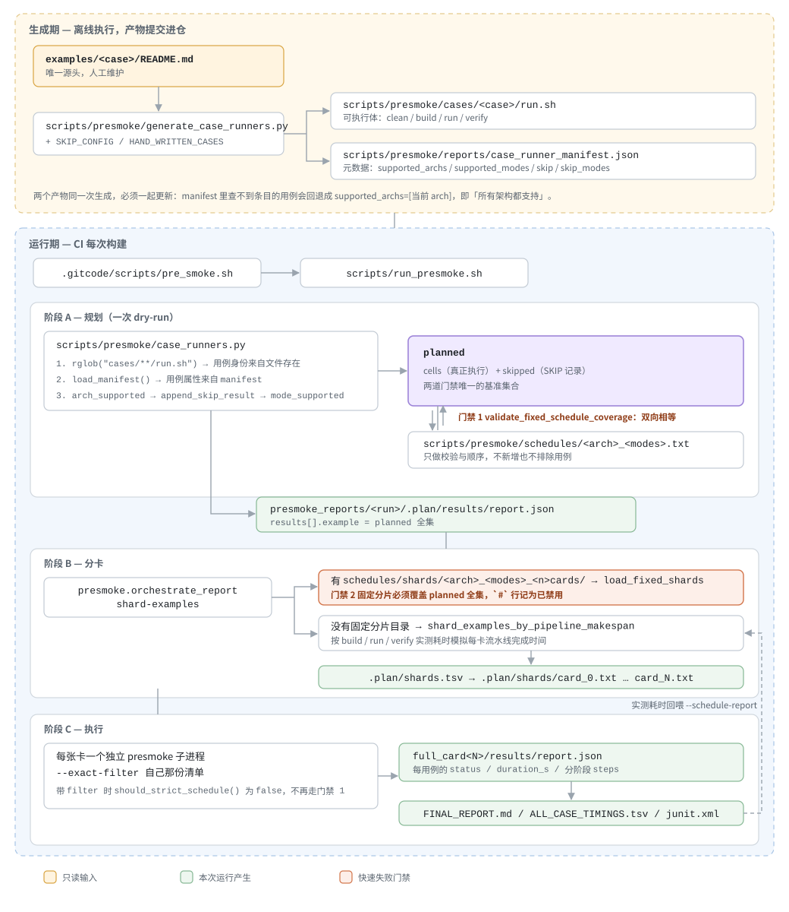

# Presmoke 看护入口

`scripts/run_presmoke.sh` 是 CI 和人工看护入口。该脚本会执行一轮完整的 910B 或 950 presmoke，生成可归档报告，并支持将超时用例切换到其他卡上重试。

如需直接调试 Python CLI，可以使用 `PYTHONPATH=scripts PRESMOKE_PROJECT_ROOT=$PWD python3 -m presmoke ...`。

执行全量看护前，编排脚本会清理当前 CANN `opp/vendors` 目录下的所有内容，保证自定义算子包安装状态可复现。带 `--filter` 或 `--dry-run` 的运行不会清理 `opp/vendors`。

## 用例流动



一个用例从 README 走到某张卡上执行，要经过两段性质完全不同的流程。

**生成期**离线执行，产物提交进仓。`generate_case_runners.py` 从 `examples/<case>/README.md` 的「编译运行」段一次产出两样东西：`cases/<case>/run.sh` 是可执行体，`reports/case_runner_manifest.json` 是元数据。两者必须一起更新 —— manifest 里查不到条目的用例，`load_runner_info` 会回退成 `supported_archs=[当前 arch]`，等同于「所有架构都支持」，于是其他架构的用例也会被算进本架构的待执行集合。

**运行期**由 CI 触发。用例的身份来自 `rglob("cases/**/run.sh")`，属性来自 manifest，经架构、skip 和模式过滤后得到 `planned` —— 真正执行的 `cells` 加上 `SKIP` 记录。`planned` 是后续所有校验唯一的基准集合。

`schedules/` 和 `schedules/shards/` 都是运行期的只读输入，各自独立对着同一个 `planned` 校验，互不替代：

| 门禁 | 位置 | 要求 |
|---|---|---|
| 1 | `cli.py` 的 `validate_fixed_schedule_coverage` | 调度表与 `planned` 双向集合相等 |
| 2 | `orchestrate_report.py` 的 `load_fixed_shards` | 固定分片覆盖全部 `planned` |

调度表里的 `#` 注释行只是把用例从 `planned` 里扣掉（`temporarily_disabled_names`），对门禁 2 完全不起作用，分片文件需要自己的 `#` 行。此外，「在 `planned` 里但不执行」更常见的写法是保留活跃行并在 manifest 里标 `skip`，这样 presmoke 会如实报出 `SKIP` 和原因。

整条链上唯一的写入目标是最后的 `presmoke_reports/`；`run.sh`、manifest、调度表和固定分片四者都是只读输入。

## 快速开始

使用默认参数运行。该命令最短，并保持与旧 `run_presmoke.sh` 调用方约定兼容：

```bash
bash scripts/run_presmoke.sh
```

默认行为：

- `ARCH=dav-2201`，对应 910B。
- `MODES=npu`。
- `NPU_CARDS=auto`，优先检测可见的 `/dev/davinci*` 卡并并行运行。
- `PRIMARY_CARD=0`，仅在自动检测不到 NPU 卡，或强制单轮运行时作为兜底主卡。
- `SCHEDULE=fixed`。
- `JOBS=auto`。
- `NPU_SLOTS=1`。
- `TIMEOUT=120`，只作用于 NPU run 命令。
- 成功时打印 `execute samples success`；失败时打印 `execute samples failed` 并返回非 0。

## 常用命令

只查看计划运行哪些用例，不实际执行：

```bash
bash scripts/run_presmoke.sh --dry-run
```

只执行编译阶段，不执行 run 和 verify。该模式使用单个工作目录并保留编译产物：

```bash
bash scripts/run_presmoke.sh --stages build
```

只编译指定用例：

```bash
bash scripts/run_presmoke.sh --stages build \
  --exact-filter 01_simd_cpp_api/01_utilities/02_dump/simple_dump
```

指定 910B 的某张卡运行：

```bash
NPU_CARDS=7 PRIMARY_CARD=7 bash scripts/run_presmoke.sh
```

运行 950：

```bash
ARCH=dav-3510 PRIMARY_CARD=0 bash scripts/run_presmoke.sh
```

运行单个用例：

```bash
bash scripts/run_presmoke.sh \
  --filter 01_simd_cpp_api/03_basic_api/03_matrix_compute/mmad_unitflag
```

指定报告输出目录：

```bash
OUT_ROOT=/tmp/presmoke_910b_card7 \
PRIMARY_CARD=7 \
bash scripts/run_presmoke.sh
```

显式运行 CPU 模式。CPU 模式不是默认模式：

```bash
MODES=cpu bash scripts/run_presmoke.sh
```

CPU 模式用例较慢时，可以提高 CPU run 超时时间：

```bash
MODES=cpu CPU_RUN_TIMEOUT=1800 bash scripts/run_presmoke.sh
```

## CI 命令

910B：

```bash
PROJECT_ROOT=/path/to/asc-devkit \
ARCH=dav-2201 \
PRIMARY_CARD=7 \
RETRY_CARDS="0 1 2 3 4 5 6" \
bash scripts/run_presmoke.sh
```

950：

```bash
PROJECT_ROOT=/path/to/asc-devkit \
ARCH=dav-3510 \
PRIMARY_CARD=0 \
bash scripts/run_presmoke.sh
```

950 dry-run：

```bash
ARCH=dav-3510 PRIMARY_CARD=0 bash scripts/run_presmoke.sh --dry-run
```

910B dry-run：

```bash
ARCH=dav-2201 PRIMARY_CARD=7 bash scripts/run_presmoke.sh --dry-run
```

## 参数

| 变量 | 默认值 | 含义 |
|---|---|---|
| `PROJECT_ROOT` | 脚本所在仓库根目录 | 要运行的 asc-devkit checkout。 |
| `ASCEND_HOME_DIR` | `/usr/local/Ascend/ascend-toolkit/latest` | CANN toolkit 根目录，目录下应包含 `set_env.sh`。 |
| `ARCH` | `dav-2201` | 目标架构。910B 使用 `dav-2201`，950 使用 `dav-3510`。 |
| `NPU_CARDS` | `auto` | NPU 模式使用的卡。`auto` 优先检测可见的 `/dev/davinci*`，再回退到 `npu-smi`。如需强制单卡运行，可设置 `NPU_CARDS=7`。 |
| `PRIMARY_CARD` | `0` | 自动检测不到卡，或运行被强制为单轮模式时使用的兜底主卡。 |
| `RETRY_CARDS` | 空 | 超时用例重试使用的卡号，多个卡号用空格分隔。 |
| `JOBS` | `auto` | 并行 build worker 数。NPU 模式使用保守的 CPU 数阶梯；纯 CPU 模式使用 `ceil(CPU(s) / 4)`，最大值为 64。 |
| `NPU_SLOTS` | `1` | NPU 队列并发度。看护运行建议保持为 `1`。 |
| `CPU_RUN_SLOTS` | `auto` | 纯 CPU 模式的 run worker 数。`auto` 使用 `lscpu` 中的主机 `CPU(s)`。NPU 模式忽略该参数。 |
| `MAKE_JOBS` | `auto` | 单个 case 的 `make -j` 上限。`auto` 使用 `CPU(s) / resolved JOBS`；显式 `make -j` 命令会被 presmoke wrapper 限制。 |
| `TIMEOUT` | `120` | NPU run 命令超时时间，单位秒。Build 和 verify 命令不使用该超时。 |
| `CPU_RUN_TIMEOUT` | `300` | CPU run 命令超时时间，单位秒。CPU-only 验证较慢时可调大。 |
| `SCHEDULE` | `fixed` | 用例提交顺序。看护运行建议使用 `fixed`。 |
| `SCHEDULE_FILE` | 内置文件 | 可选的固定顺序覆盖文件。 |
| `SCHEDULE_REPORT` | 空 | 可选的历史报告或 `ALL_CASE_TIMINGS.tsv`。显式设置时，多卡分片根据该报告重新计算，不使用内置固定分片。 |
| `OUT_ROOT` | `presmoke_reports/presmoke_<arch>_<timestamp>` | CI 归档使用的输出目录。 |
| `MODES` | `npu` | Presmoke 运行模式。 |
| `MODE` | 未设置 | 仅当 `MODES` 未设置时使用的别名，例如 `MODE=cpu`。 |

CPU 调试模式需要显式开启。使用 `MODES=cpu` 或 `MODE=cpu`；默认看护路径仍为 `npu`。CPU 模式默认不使用 NPU fixed schedule，除非显式提供 `SCHEDULE_FILE`。

CPU 模式的默认并行度根据主机 CPU 数计算，不针对特定机器写死。例如，192 CPU 主机会解析为 `JOBS=48`、`MAKE_JOBS=4`、`CPU_RUN_SLOTS=192`；88 CPU 主机会解析为 `JOBS=22`、`MAKE_JOBS=4`、`CPU_RUN_SLOTS=88`。

## 多卡分片与执行模型

NPU 全量运行采用“一次规划、多卡分片、每卡独立流水执行、最终统一汇总”的模型：

1. `NPU_CARDS=auto` 优先扫描 `/dev/davinci*`，扫描不到时回退到 `npu-smi`，再无法检测时使用 `PRIMARY_CARD`。
2. 编排器先执行一次 dry-run，得到经过架构、模式、schedule 和 skip 规则筛选后的完整 case 列表。
3. 如果存在与架构、模式和卡数匹配的内置固定分片，且未显式设置 `SCHEDULE_REPORT`，编排器直接使用该分片。否则分片器读取历史 `build`、`run`、`verify` 耗时，模拟每张卡的流水线完成时间；缺少阶段耗时时，退化为按总耗时做最长任务优先的贪心均衡。
4. 每张卡启动一个独立 runner。该 runner 使用 `JOBS` 个 build worker、`NPU_SLOTS` 个 NPU run worker 和 `JOBS` 个 verify worker；默认 `NPU_SLOTS=1`，即每张卡只保留一条 NPU FIFO 执行队列。
5. 所有卡结束后合并每卡报告。全量 elapsed time 由最早开始时间到最晚结束时间计算，因此分片目标是让各卡预计耗时和结束时间尽量接近，而不是让 case 数量完全相同。

以下情况强制使用单轮执行，不进行多卡分片：`--dry-run`、`--filter`、`--exact-filter`、`--exclude` 和 `--stages build`。

多卡运行根据主机 CPU 数计算每卡可用 CPU：`ceil(CPU(s) / card_count)`，再为每张卡独立解析 `JOBS`、`MAKE_JOBS` 和 `CPU_RUN_SLOTS`。显式设置这些变量时，显式值优先。

`custom_op` 算子包的 `make -j binary package` 固定使用 16 路编译，优先缩短全量运行的自定义算子包编译关键路径；同一分片中的其他 case 继续使用按每卡 CPU 数计算的 `MAKE_JOBS`。

为了避免自定义算子包的安装和消费跨卡冲突，以下 case 作为一个不可拆分的分片组，始终分配到同一张卡：

```text
custom_op_static_lib
└── custom_op
    ├── aclnn_invocation
    ├── aclop_invocation
    ├── onnx_plugin
    ├── tensorflow_builtin
    ├── tensorflow_custom
    └── tiling_sink_programming

以上依赖任务结束
└── parallel_ops_package
```

`custom_op_static_lib` 或 `custom_op` 失败时，其硬依赖 case 会标记为 `SKIP: prerequisite failed`，不会继续执行命令。`parallel_ops_package` 可以提前 build，但 run 必须等待 `custom_op` 及其依赖 case 全部结束。其他 case（包括同一 source case 的不同 scenario）可以独立分配到不同卡。

分片计划写入 `presmoke_reports/<run>/.plan/shards.tsv` 和 `.plan/shards/card_<id>.txt`；这些临时计划会在最终报告生成后自动清理。每张卡的实际 case、阶段耗时和起止时间保存在 `full_card<id>/results/report.json` 中，可用于检查多卡负载和结束时间是否均衡。

910B 8 卡看护的固定分片位于 `scripts/presmoke/schedules/shards/dav-2201_npu_8cards/card_<index>.txt`。文件只保存逻辑 shard 和 case 的对应关系，不保存或提交历史耗时 TSV。运行时逻辑 shard 按顺序映射到实际检测到的卡号，并严格校验 planned case 是否恰好出现一次；case 新增、删除、重复或遗漏都会快速失败。显式设置 `SCHEDULE_REPORT` 可绕过固定分片并根据指定报告重新计算。

## 报告

编排脚本会生成：

- `status.txt`：高层进度和最终输出位置。
- `full_card<N>/meta.txt`：环境、卡号、耗时和 `npu-smi` 快照。
- `full_card<N>/stdout.log` 和 `stderr.log`：wrapper 原始日志。
- `full_card<N>/results/report.json`：机器可读的 presmoke 报告。
- `full_card<N>/results/report.md`：详细 Markdown 报告。
- `full_card<N>/results/logs/<case>__<mode>.log`：每个 case 的完整命令日志。
- `full_card<N>/results/logs/stages/<case>__<mode>__<stage>.log`：build、run、verify 等阶段日志。
- `FINAL_REPORT.md`：包含失败和重试结果的简要汇总。
- `ALL_CASE_TIMINGS.tsv`：每个 case 的耗时、NPU 等待时间、步骤详情和实际执行命令。
- `FAILURES.tsv`：主运行中的失败或跳过结果，以及重试结果。

每轮执行完成后，编排器会保留汇总、JUnit、TSV、每卡元信息、机器可读报告以及 case/stage 日志。
调度 `.plan`、运行状态 `.state`、分片 `.locks` 和 case build 产物会自动删除，
不属于 CI 归档内容。

## 固定顺序

默认固定顺序文件为：

- `scripts/presmoke/schedules/dav-2201_npu.txt`
- `scripts/presmoke/schedules/dav-3510_npu.txt`

这些顺序会保留自定义算子依赖约束：

- `custom_op_static_lib` 在 `custom_op` 之前运行。
- `parallel_ops_package` 的 run 在 `custom_op` 及其依赖用例全部结束后运行。
- `aclnn`、`aclop`、`onnx`、`tensorflow` 和 `tiling_sink` 在 `custom_op` 之后运行。

不在 schedule 文件中的新增 case 会追加到末尾，然后再次强制应用自定义算子依赖顺序。
全量看护入口默认开启 fixed schedule 覆盖检查，因此过期或缺失的顺序项会快速失败。

基于上一轮运行结果重新生成固定顺序：

```bash
PYTHONPATH=scripts PRESMOKE_PROJECT_ROOT=$PWD python3 -m presmoke \
  --arch dav-2201 \
  --modes npu \
  --jobs auto \
  --schedule npu-idle-min \
  --schedule-report presmoke_reports/latest/full_card7/results/report.json \
  --export-schedule scripts/presmoke/schedules/dav-2201_npu.txt \
  --dry-run \
  --report-format json \
  --results /tmp/presmoke_schedule_export
```

## 注意事项

- 不要在同一个 checkout 中同时运行多个编排脚本。`.presmoke_locks` 下的锁会防止误重入。
- 全量看护入口会清理当前 CANN `opp/vendors` 目录，请确认 CI 用户有权限删除并重新安装自定义算子 vendor 包。
- 需要 TensorFlow 2.6.5 的 TensorFlow 用例会在 case manifest 中显式跳过。
- 超时重试只针对 timeout 用例。非 timeout 失败会直接汇总，留待进一步定位。
