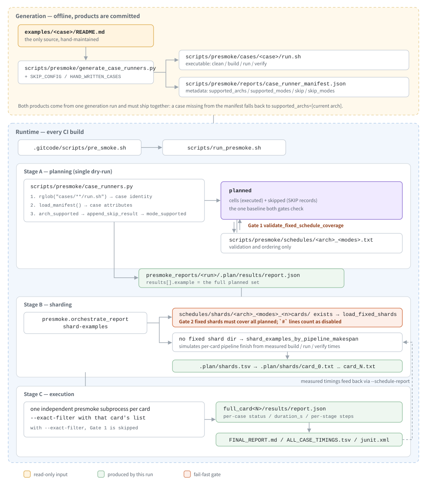

# Presmoke Watch Entry

`scripts/run_presmoke.sh` is the CI and manual watch entry. It runs one full 910B or 950 presmoke round, writes archiveable reports, and can retry timeout cases on other cards.

For direct Python CLI experiments, use `PYTHONPATH=scripts PRESMOKE_PROJECT_ROOT=$PWD python3 -m presmoke ...`.

Before a full watch run, the orchestrator removes all entries under the active CANN `opp/vendors` directory. This keeps custom-op package installation deterministic across rounds. Runs with `--filter` or `--dry-run` do not clean `opp/vendors`.

## How a Case Flows



Getting a case from its README onto a card goes through two very different pipelines.

**Generation** runs offline and its products are committed. `generate_case_runners.py` reads the build-and-run section of `examples/<case>/README.md` and emits two things in one pass: `cases/<case>/run.sh` is the executable, `reports/case_runner_manifest.json` is the metadata. They must be updated together — a case with no manifest entry makes `load_runner_info` fall back to `supported_archs=[current arch]`, which means "every arch", so cases belonging to another arch end up in this arch's planned set.

**Runtime** is driven by CI. Case identity comes from `rglob("cases/**/run.sh")` and case attributes come from the manifest. After the arch, skip and mode filters, what remains is `planned` — the `cells` that actually execute plus the `SKIP` records. Everything downstream is checked against that one set.

`schedules/` and `schedules/shards/` are both read-only runtime inputs. They check the same `planned` set independently and neither substitutes for the other:

| Gate | Location | Requirement |
|---|---|---|
| 1 | `validate_fixed_schedule_coverage` in `cli.py` | schedule file and `planned` must be set-equal in both directions |
| 2 | `load_fixed_shards` in `orchestrate_report.py` | fixed shards must cover all of `planned` |

A `#` line in the schedule file only subtracts the case from `planned` (`temporarily_disabled_names`); it does nothing for gate 2, where the shard files need their own `#` lines. The more common way to express "planned but not executed" is to keep the line active and mark `skip` in the manifest, so presmoke reports a real `SKIP` with its reason.

The only write target in the whole chain is `presmoke_reports/` at the end; `run.sh`, the manifest, the schedule files and the fixed shards are all read-only inputs.

## Quick Start

Run with defaults. This is the shortest command and is intended to be compatible with the old `run_presmoke.sh` caller contract:

```bash
bash scripts/run_presmoke.sh
```

Default behavior:

- `ARCH=dav-2201`, for 910B.
- `MODES=npu`.
- `NPU_CARDS=auto`, detect visible `/dev/davinci*` cards and run them in parallel.
- `PRIMARY_CARD=0`, used only when auto detection finds no NPU card or for single-run fallbacks.
- `SCHEDULE=fixed`.
- `JOBS=auto`.
- `NPU_SLOTS=1`.
- `TIMEOUT=120`, applied only to NPU run commands.
- Success prints `execute samples success`; failure prints `execute samples failed` and exits non-zero.

## Common Commands

Check which cases would run without executing them:

```bash
bash scripts/run_presmoke.sh --dry-run
```

Run only the build stage, without run or verify. This mode uses one workspace and preserves build artifacts:

```bash
bash scripts/run_presmoke.sh --stages build
```

Build one case only:

```bash
bash scripts/run_presmoke.sh --stages build \
  --exact-filter 01_simd_cpp_api/01_utilities/02_dump/simple_dump
```

Run 910B on a specific card:

```bash
NPU_CARDS=7 PRIMARY_CARD=7 bash scripts/run_presmoke.sh
```

Run 950:

```bash
ARCH=dav-3510 PRIMARY_CARD=0 bash scripts/run_presmoke.sh
```

Run one case:

```bash
bash scripts/run_presmoke.sh \
  --filter 01_simd_cpp_api/03_basic_api/03_matrix_compute/mmad_unitflag
```

Write reports to a specific directory:

```bash
OUT_ROOT=/tmp/presmoke_910b_card7 \
PRIMARY_CARD=7 \
bash scripts/run_presmoke.sh
```

Run CPU mode explicitly. CPU mode is not the default:

```bash
MODES=cpu bash scripts/run_presmoke.sh
```

Increase CPU run timeout for slow CPU-mode cases:

```bash
MODES=cpu CPU_RUN_TIMEOUT=1800 bash scripts/run_presmoke.sh
```

## CI Commands

910B:

```bash
PROJECT_ROOT=/path/to/asc-devkit \
ARCH=dav-2201 \
PRIMARY_CARD=7 \
RETRY_CARDS="0 1 2 3 4 5 6" \
bash scripts/run_presmoke.sh
```

950:

```bash
PROJECT_ROOT=/path/to/asc-devkit \
ARCH=dav-3510 \
PRIMARY_CARD=0 \
bash scripts/run_presmoke.sh
```

950 dry-run:

```bash
ARCH=dav-3510 PRIMARY_CARD=0 bash scripts/run_presmoke.sh --dry-run
```

910B dry-run:

```bash
ARCH=dav-2201 PRIMARY_CARD=7 bash scripts/run_presmoke.sh --dry-run
```

## Parameters

| Variable | Default | Meaning |
|---|---|---|
| `PROJECT_ROOT` | script parent repo | asc-devkit checkout to run. |
| `ASCEND_HOME_DIR` | `/usr/local/Ascend/ascend-toolkit/latest` | CANN toolkit root containing `set_env.sh`. |
| `ARCH` | `dav-2201` | Target arch. Use `dav-2201` for 910B and `dav-3510` for 950. |
| `NPU_CARDS` | `auto` | NPU cards used by NPU mode. `auto` detects visible `/dev/davinci*` first, then falls back to `npu-smi`. Set `NPU_CARDS=7` for a forced single-card run. |
| `PRIMARY_CARD` | `0` | Fallback/main NPU card id when auto detection finds no cards or the run is forced to single-run mode. |
| `RETRY_CARDS` | empty | Space-separated card ids for retrying timeout cases. |
| `JOBS` | `auto` | Parallel build workers. NPU mode uses a conservative CPU-count ladder; CPU-only mode uses `ceil(CPU(s) / 4)`, capped at 64. |
| `NPU_SLOTS` | `1` | NPU queue concurrency. Keep `1` for watch runs. |
| `CPU_RUN_SLOTS` | `auto` | CPU-only run workers. `auto` uses host `CPU(s)` from `lscpu`. Ignored by NPU mode. |
| `MAKE_JOBS` | `auto` | Per-case `make -j` limit. `auto` uses `CPU(s) / resolved JOBS`; explicit `make -j` commands are capped by the presmoke wrapper. |
| `TIMEOUT` | `120` | Timeout in seconds for NPU run commands. Build and verify commands do not use this timeout. |
| `CPU_RUN_TIMEOUT` | `300` | Timeout in seconds for CPU run commands. Increase this when CPU-only validation is slower than expected. |
| `SCHEDULE` | `fixed` | Case submit order. Watch runs should use `fixed`. |
| `SCHEDULE_FILE` | built-in | Optional fixed order override. |
| `SCHEDULE_REPORT` | empty | Optional historical report or `ALL_CASE_TIMINGS.tsv`. When set explicitly, multi-card assignments are recalculated from the report instead of using a built-in fixed shard. |
| `OUT_ROOT` | `presmoke_reports/presmoke_<arch>_<timestamp>` | Output directory for CI archive. |
| `MODES` | `npu` | Presmoke modes. |
| `MODE` | unset | Alias used only when `MODES` is unset. For example, `MODE=cpu`. |

CPU debug mode is opt-in. Use `MODES=cpu` or `MODE=cpu`; the default watch path remains `npu`. CPU mode does not use the NPU fixed schedule unless `SCHEDULE_FILE` is explicitly provided.

For CPU mode, the default parallelism is computed from the host CPU count instead of hard-coded for specific machines. For example, a 192-CPU host resolves to `JOBS=48`, `MAKE_JOBS=4`, and `CPU_RUN_SLOTS=192`; an 88-CPU host resolves to `JOBS=22`, `MAKE_JOBS=4`, and `CPU_RUN_SLOTS=88`.

## Multi-card Sharding and Execution Model

A full NPU run follows the model of one planning pass, multi-card sharding, an independent pipeline per card, and one final merged report:

1. With `NPU_CARDS=auto`, the orchestrator scans `/dev/davinci*` first, falls back to `npu-smi`, and uses `PRIMARY_CARD` if neither method detects a card.
2. The orchestrator performs one dry-run to obtain the complete case list after architecture, mode, schedule, and skip rules are applied.
3. If a built-in fixed shard matches the architecture, mode, and card count, and `SCHEDULE_REPORT` is not set, the orchestrator uses that shard directly. Otherwise, the sharder reads historical `build`, `run`, and `verify` durations and simulates pipeline completion time; without stage timings, it falls back to longest-job-first greedy balancing using total case duration.
4. Each card starts one independent runner with `JOBS` build workers, `NPU_SLOTS` NPU run workers, and `JOBS` verify workers. The default `NPU_SLOTS=1` keeps one NPU FIFO execution queue per card.
5. Per-card reports are merged after all cards finish. Full-run elapsed time is measured from the earliest start to the latest finish, so sharding aims to make card durations and finish times as close as possible rather than assigning the same number of cases to every card.

The following options force a single run instead of multi-card sharding: `--dry-run`, `--filter`, `--exact-filter`, `--exclude`, and `--stages build`.

For multi-card runs, per-card CPU capacity is computed as `ceil(CPU(s) / card_count)`, then `JOBS`, `MAKE_JOBS`, and `CPU_RUN_SLOTS` are resolved independently for each card. Explicit environment values override the automatic values.

The `make -j binary package` command for the `custom_op` package uses 16-way parallelism to shorten the custom-op build on the full-run critical path. Other cases in the same shard keep the `MAKE_JOBS` value calculated from their per-card CPU capacity.

To avoid cross-card conflicts between custom-op package installation and consumers, the following cases form one indivisible shard group and always run on the same card:

```text
custom_op_static_lib
└── custom_op
    ├── aclnn_invocation
    ├── aclop_invocation
    ├── onnx_plugin
    ├── tensorflow_builtin
    ├── tensorflow_custom
    └── tiling_sink_programming

After the dependent cases finish
└── parallel_ops_package
```

If `custom_op_static_lib` or `custom_op` fails, hard dependents are marked `SKIP: prerequisite failed` and their commands are not executed. `parallel_ops_package` may build early, but its run waits until `custom_op` and all dependent cases finish. Other cases, including scenarios from the same source case, may be assigned to different cards.

The shard plan is written to `presmoke_reports/<run>/.plan/shards.tsv` and `.plan/shards/card_<id>.txt`; these temporary files are removed after the final report is generated. The actual case list, stage durations, and start/finish times for each card remain in `full_card<id>/results/report.json` and can be used to evaluate load and finish-time balance.

The fixed shard for an 8-card 910B watch run is stored under `scripts/presmoke/schedules/shards/dav-2201_npu_8cards/card_<index>.txt`. These files contain only the logical-shard-to-case mapping; historical timing TSV files are not stored or committed. Logical shards are mapped in order to the detected physical card ids, and coverage validation requires every planned case to appear exactly once. Added, removed, duplicated, or missing cases fail fast. Set `SCHEDULE_REPORT` explicitly to bypass the fixed shard and recalculate assignments from that report.

## Reports

The orchestrator writes:

- `status.txt`: high-level progress and final location.
- `full_card<N>/meta.txt`: env, card, elapsed time, and `npu-smi` snapshots.
- `full_card<N>/stdout.log` and `stderr.log`: raw wrapper logs.
- `full_card<N>/results/report.json`: machine-readable presmoke report.
- `full_card<N>/results/report.md`: detailed Markdown report.
- `full_card<N>/results/logs/<case>__<mode>.log`: full per-case command log.
- `full_card<N>/results/logs/stages/<case>__<mode>__<stage>.log`: per-stage command logs for build, run, and verify.
- `FINAL_REPORT.md`: concise summary with failures and retry results.
- `ALL_CASE_TIMINGS.tsv`: per-case timing, NPU wait, step details, and executed commands.
- `FAILURES.tsv`: failed or skipped primary results plus retry outcome.

After each run, the orchestrator retains summaries, JUnit, TSV files, per-card metadata, machine-readable reports,
and case/stage logs. Scheduling `.plan`, runtime `.state`, shard `.locks`, and case build
artifacts are removed automatically and are not part of the CI artifacts.

## Fixed Schedule

The default fixed schedules are:

- `scripts/presmoke/schedules/dav-2201_npu.txt`
- `scripts/presmoke/schedules/dav-3510_npu.txt`

They preserve the required custom-op ordering:

- `custom_op_static_lib` runs before `custom_op`.
- The run stage of `parallel_ops_package` starts after `custom_op` and all of its dependent cases finish.
- `aclnn`, `aclop`, `onnx`, `tensorflow`, and `tiling_sink` run after `custom_op`.

New cases not listed in a schedule file are appended to the end, then the custom-op dependency order is enforced again.
The full watch entry enables strict fixed-schedule coverage checks by default, so stale or missing entries fail fast.

To regenerate a fixed schedule from a previous run:

```bash
PYTHONPATH=scripts PRESMOKE_PROJECT_ROOT=$PWD python3 -m presmoke \
  --arch dav-2201 \
  --modes npu \
  --jobs auto \
  --schedule npu-idle-min \
  --schedule-report presmoke_reports/latest/full_card7/results/report.json \
  --export-schedule scripts/presmoke/schedules/dav-2201_npu.txt \
  --dry-run \
  --report-format json \
  --results /tmp/presmoke_schedule_export
```

## Notes

- Do not run multiple orchestrators in the same checkout at the same time. A lock under `.presmoke_locks` protects against accidental overlap.
- The full watch entry cleans the active CANN `opp/vendors` directory. Make sure the CI user has permission to remove and reinstall custom-op vendor packages.
- TensorFlow cases that require TensorFlow 2.6.5 are intentionally skipped by the case manifest.
- Timeout retry is for timeout cases only. Non-timeout failures are reported and left for diagnosis.
